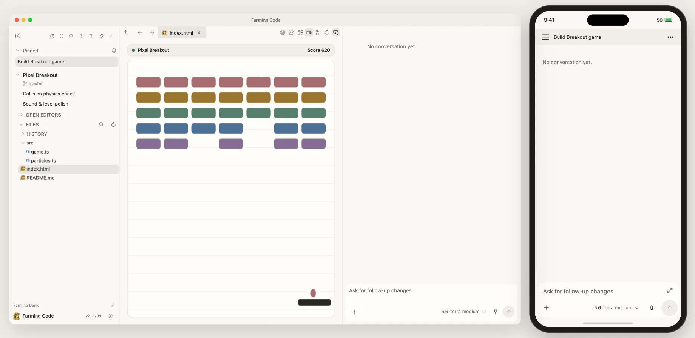

# Farming v2.2.98

[简体中文](./v2.2.98.zh_cn.md)

[](https://zhuwenzhuang.github.io/farming/en/#interactive-demo)

## Agent sessions

- Use Antigravity’s native ACP server, show native child sessions, and keep Full access scoped to the session. A `/goal` submission appears once, and you can steer an active Antigravity or Qwen turn without starting a separate turn in Farming.
- Show OpenCode retry progress and child output in the right session. Display ACP context compaction summaries, native command output, and exit status in Chat.
- Read model choices from provider catalogs and preserve inherited Composer settings when choosing a model. Update the managed Codex runtime to 0.167.2, Codex ACP to 2.6.0, Claude ACP to 0.106.0, and the ACP SDK to 2.6.0.

## Workspace and settings

- Keep Mermaid diagrams and attached images within the Chat layout. Restore Git blame when returning to a file tab and improve annotation contrast across appearances.
- Keep Browser and Computer preference saves separate from resource start and stop operations. Preserve editor diagnostics across supported file operations.

## Installation

```bash
npm install -g farming-code@2.2.98 --registry=https://registry.npmjs.org
```
