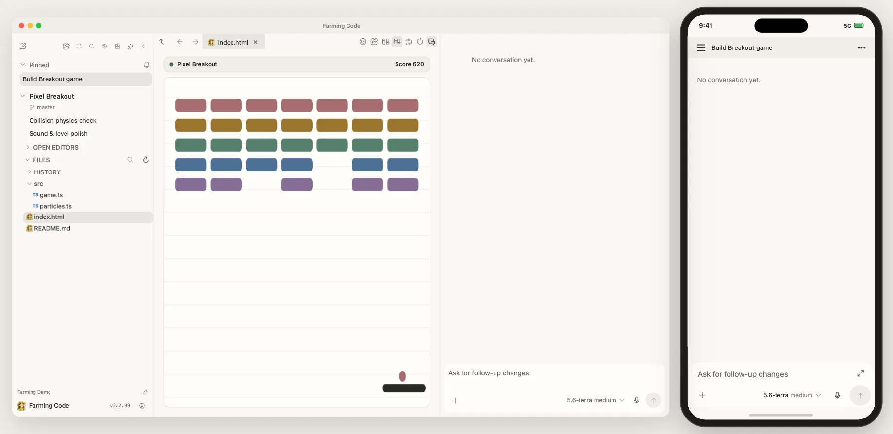

# Farming v2.2.99

[English](./v2.2.99.md)

[](https://zhuwenzhuang.github.io/farming/cn/#interactive-demo)

## Agent 会话

- 使用 Antigravity 原生 ACP 服务，展示原生子会话，并将完全访问权限限制在当前会话。提交 `/goal` 只显示一次；Antigravity 和 Qwen 支持在执行中追加指令，Farming 会保留原来的对话轮次。
- 在对应会话中展示 OpenCode 重试进度和子会话输出。在对话中显示 ACP 上下文压缩摘要、原生命令输出和退出状态。
- 从供应商目录读取模型选项，并在切换模型时保留输入框的继承设置。托管 Codex 运行时更新至 0.167.2，Codex ACP 更新至 2.6.0，Claude ACP 更新至 0.106.0，ACP SDK 更新至 2.6.0。

- CRT 的终端输入结果不确定时，刷新检查点以恢复输入，不重发上一条输入。

## 工作区与设置

- Mermaid 图和图片附件保持在对话布局范围内。切回文件标签页时恢复 Git blame，并改善各主题下的注释对比度。
- 保存 Browser 和 Computer 偏好设置与启动、停止资源相互独立。在支持的文件操作中保留编辑器诊断。
- 即使服务器没有本地 Chromium，只要有可用的 Browser 来源，就能启用插件。
- 切换 Chat 或 Terminal 失败时，Browser 和 Computer 资源仍归原 Agent。切换成功后，停止 Config 仍能验证归属并停止对应的 Computer 容器。

## 安装

```bash
npm install -g farming-code@2.2.99 --registry=https://registry.npmjs.org
```
